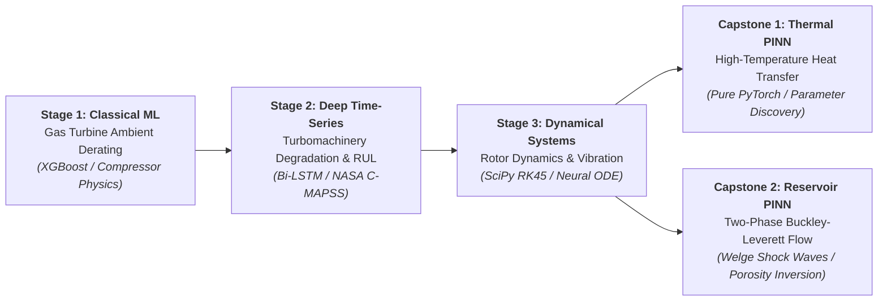

# Mohammed Basra

<p align="center">
  
</p>

<p align="center">
  <a href="https://github.com/mohammedbasra-star"></a>
  <a href="mailto:mohammedbasra.star@gmail.com"></a>
  
  
</p>

---

## 🔬 About Me

I am a Mechanical Engineer and Scientific Machine Learning researcher specializing in the intersection of **Physics-Informed Deep Learning (PINNs)**, **Dynamical Systems**, and **Turbomachinery & Reservoir Dynamics**. 

My research bridges classical physical principles (Navier-Stokes, Buckley-Leverett porous media flow, Brayton thermodynamic cycles, and rotor vibration dynamics) with modern deep learning and neural differential equation solvers to enable high-accuracy predictive maintenance, physical parameter discovery, and real-time scientific simulation.

---

## 🚀 The Graduated Research Pathway (Scientific Machine Learning)

My academic repositories follow a **logically graduated progression** demonstrating continuous mastery from classical statistical thermofluid modeling to cutting-edge Physics-Informed Neural Networks:



---

## 📂 Featured Research Repositories

### 1. [pinn-thermo-dynamics](https://github.com/mohammedbasra-star/pinn-thermo-dynamics)
**Physics-Informed Neural Network (PINN) for High-Temperature Turbomachinery Heat Transfer**
- Solves 2D nonlinear unsteady thermal conduction governed by $\rho c_p \frac{\partial T}{\partial t} = \nabla \cdot (k \nabla T) + Q$.
- Validated against $256 \times 256$ analytical and Crank-Nicolson numerical ground truth ($L_2 \text{ error} \approx 1.15 \times 10^{-4}$).
- Inverse parameter discovery of unknown thermal diffusivity $\alpha$ with $< 0.35\%$ error.
- [](https://colab.research.google.com/github/mohammedbasra-star/pinn-thermo-dynamics/blob/main/notebooks/quickstart.ipynb)

### 2. [pinn-reservoir-dynamics](https://github.com/mohammedbasra-star/pinn-reservoir-dynamics)
**Physics-Informed Neural Network for Two-Phase Porous Media Flow & Buckley-Leverett Shock Waves**
- Solves nonlinear hyperbolic Buckley-Leverett saturation PDE with Welge fractional flow shock fronts: $\phi \frac{\partial S_w}{\partial t} + u_t \frac{\partial f_w}{\partial x} = 0$.
- Upwind Finite Difference numerical benchmark on $65,536$ spatiotemporal grid points.
- Inverse reservoir history matching for physical porosity discovery ($\phi \to 0.20$).
- [](https://colab.research.google.com/github/mohammedbasra-star/pinn-reservoir-dynamics/blob/main/notebooks/quickstart_reservoir_demo.ipynb)

### 3. [turbomachinery-rotor-dynamics-ode-](https://github.com/mohammedbasra-star/turbomachinery-rotor-dynamics-ode-)
**Dynamical Systems Modeling, 2-DOF Jeffcott Rotor Vibration & PyTorch Neural ODEs**
- Mathematical modeling of rotor lateral vibration with mass unbalance and bearing damping: $m \ddot{x} + c \dot{x} + k x = m e \omega^2 \cos(\omega t)$.
- Classical Runge-Kutta (RK45) simulator vs differentiable Neural ODE solver.
- Campbell / Bode frequency response and Campbell resonance peak ($500.0\mu\text{m}$ at $954.9\text{ RPM}$).
- System identification of bearing damping ($c$) and unbalance eccentricity ($e$) directly from vibration telemetry.
- [](https://colab.research.google.com/github/mohammedbasra-star/turbomachinery-rotor-dynamics-ode-/blob/main/notebooks/rotor_dynamics_demo.ipynb)

### 4. [turbomachinery-degradation-lstm-](https://github.com/mohammedbasra-star/turbomachinery-degradation-lstm-)
**Deep Temporal Prognostics & Remaining Useful Life (RUL) Forecasting on NASA C-MAPSS**
- Continuous wear tracking for 100 aircraft turbofan engines using 14 degradation-sensitive sensor channels.
- Optimized using the official **NASA Asymmetric Scoring Function** penalizing delayed maintenance.
- Bidirectional LSTM achieved **$10.28\text{ cycles}$ Test RMSE** and minimal industrial risk ($S = 164.9$).
- [](https://colab.research.google.com/github/mohammedbasra-star/turbomachinery-degradation-lstm-/blob/main/notebooks/rul_quickstart_demo.ipynb)

### 5. [gas-turbine-ambient-effects-regression-](https://github.com/mohammedbasra-star/gas-turbine-ambient-effects-regression-)
**Machine Learning Benchmark for Gas Turbine Power Derating Under Ambient Climatic Effects**
- Brayton cycle thermodynamic derating analysis ($T_{amb}, P_{amb}, RH, V$) based on compressor air density loss ($\dot{m} = \rho A v$).
- Benchmark suite of 5 models trained on 9,568 full-load hourly observations (UCI CCPP).
- Tuned XGBoost achieved **$R^2 = 0.9610$** and **$\text{RMSE} = 3.364\text{ MW}$** ($0.56\%$ MAPE).
- [](https://colab.research.google.com/github/mohammedbasra-star/gas-turbine-ambient-effects-regression-/blob/main/notebooks/quickstart_demo.ipynb)

---

## 🛠️ Technical Competencies & Tooling

<div align="center">

| Domain | Core Frameworks & Libraries |
|:---|:---|
| **Scientific Machine Learning (SciML)** | `PyTorch 2.x`, `Physics-Informed Neural Networks (PINNs)`, `Neural ODEs`, `Autograd` |
| **Statistical ML & Prognostics** | `Scikit-Learn`, `XGBoost`, `Pandas`, `NumPy`, `Bidirectional LSTM`, `1D-CNN` |
| **Numerical Methods & Simulation** | `SciPy (solve_ivp, RK45)`, `Finite Difference Methods (Upwind, Crank-Nicolson)` |
| **Thermodynamics & Turbomachinery** | Brayton Cycle Derating, Rotordynamics (Jeffcott Model), NASA C-MAPSS, Heat Conduction |
| **Data Visualization & Publishing** | `Matplotlib`, `Seaborn`, `Publication 300 DPI Graphics`, `LaTeX (KaTeX)` |

</div>

---

## 📊 Summary of Research Performance Metrics

```
┌────────────────────────────────────────────────────────────────────────────────────────┐
│  PROJECT BENCHMARK PERFORMANCE DASHBOARD                                               │
├──────────────────────────────────────┬──────────────────────┬──────────────────────────┤
│  Repository                          │  Primary Metric      │  Verification Benchmark  │
├──────────────────────────────────────┼──────────────────────┼──────────────────────────┤
│  pinn-thermo-dynamics                │  L2 Error = 1.15e-4  │  Analytical 256x256 Grid │
│  pinn-reservoir-dynamics             │  L2 Error = 4.21e-3  │  Upwind FDM Shock Front  │
│  turbomachinery-rotor-dynamics-ode   │  Peak Res = 500.0 um │  RK45 Numerical Solver   │
│  turbomachinery-degradation-lstm     │  Test RMSE = 10.28 cy│  NASA C-MAPSS Fleet (100)│
│  gas-turbine-ambient-effects-regression│ R² Score = 0.9610   │  UCI CCPP (9,568 Points) │
└──────────────────────────────────────┴──────────────────────┴──────────────────────────┘
```

---

<p align="center">
  <i>"Combining fundamental physical conservation laws with modern differentiable architectures to advance energy systems engineering."</i>
</p>
