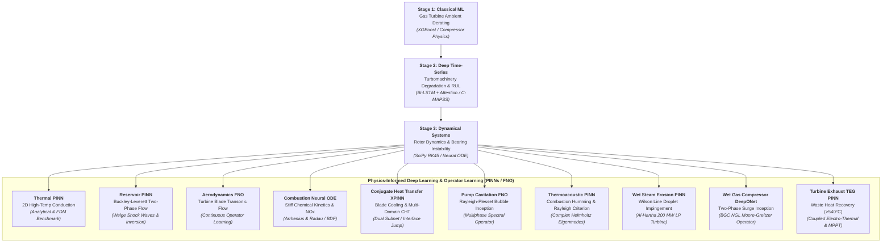

# Mohammed Basra

<p align="center">
  
</p>

<p align="center">
  <a href="https://github.com/mohammedbasra-star"></a>
  <a href="mailto:mohammedbasra.star@gmail.com"></a>
  
  
</p>

---

## 🔬 About Me

I am a Mechanical Engineer and Scientific Machine Learning researcher specializing in the intersection of **Physics-Informed Deep Learning (PINNs)**, **Dynamical Systems**, and **Turbomachinery & Reservoir Dynamics**. 

My research bridges classical physical principles (Navier-Stokes, Buckley-Leverett porous media flow, Brayton thermodynamic cycles, and rotor vibration dynamics) with modern deep learning and neural differential equation solvers to enable high-accuracy predictive maintenance, physical parameter discovery, and real-time scientific simulation.

---

## 🚀 The Graduated Research Pathway (Scientific Machine Learning)

My academic repositories follow a **logically graduated progression** demonstrating continuous mastery from classical statistical thermofluid modeling to cutting-edge Physics-Informed Neural Networks:



---

## 📂 Featured Research Repositories

### 1. [pinn-thermo-dynamics](https://github.com/mohammedbasra-star/pinn-thermo-dynamics)
**Physics-Informed Neural Network (PINN) for High-Temperature Turbomachinery Heat Transfer**
- Solves 2D nonlinear unsteady thermal conduction governed by $\rho c_p \frac{\partial T}{\partial t} = \nabla \cdot (k \nabla T) + Q$.
- Validated against $256 \times 256$ analytical and Crank-Nicolson numerical ground truth ($L_2 \text{ error} \approx 1.15 \times 10^{-4}$).
- Inverse parameter discovery of unknown thermal diffusivity $\alpha$ with $< 0.35\%$ error.
- [](https://colab.research.google.com/github/mohammedbasra-star/pinn-thermo-dynamics/blob/main/notebooks/quickstart.ipynb)

### 2. [pinn-reservoir-dynamics](https://github.com/mohammedbasra-star/pinn-reservoir-dynamics)
**Physics-Informed Neural Network for Two-Phase Porous Media Flow & Buckley-Leverett Shock Waves**
- Solves nonlinear hyperbolic Buckley-Leverett saturation PDE with Welge fractional flow shock fronts: $\phi \frac{\partial S_w}{\partial t} + u_t \frac{\partial f_w}{\partial x} = 0$.
- Upwind Finite Difference numerical benchmark on $65,536$ spatiotemporal grid points.
- Inverse reservoir history matching for physical porosity discovery ($\phi \to 0.20$).
- [](https://colab.research.google.com/github/mohammedbasra-star/pinn-reservoir-dynamics/blob/main/notebooks/quickstart_reservoir_demo.ipynb)

### 3. [turbomachinery-rotor-dynamics-ode-](https://github.com/mohammedbasra-star/turbomachinery-rotor-dynamics-ode-)
**Dynamical Systems Modeling, 2-DOF Jeffcott Rotor with Duffing Stiffness, Capone Bearing Forces & Neural ODEs**
- High-fidelity formulation: 2-DOF rotor motion with nonlinear cubic Duffing stiffness and Capone hydrodynamic short-bearing Reynolds lubrication oil-film forces ($M \ddot{r} + C \dot{r} + K r + F_{\text{nl}}(r) = F_{\text{unbalance}}(t)$).
- Classical 4th/5th-order Runge-Kutta (SciPy RK45) ground truth vs continuous-time Neural ODE vs Collocation PINN baseline.
- Spectral analysis (FFT) tracking 1X synchronous unbalance ($50.0\text{ Hz}$ at $3000\text{ RPM}$) and subharmonic hydrodynamic oil whirl ($\sim 0.46\text{X}$).
- System identification discovering unbalance eccentricity ($e$) and bearing damping ($c$) from vibration orbits.
- [](https://colab.research.google.com/github/mohammedbasra-star/turbomachinery-rotor-dynamics-ode-/blob/main/notebooks/quickstart_demo.ipynb)

### 4. [turbomachinery-degradation-lstm-](https://github.com/mohammedbasra-star/turbomachinery-degradation-lstm-)
**Deep Temporal Prognostics & Remaining Useful Life (RUL) on NASA C-MAPSS (BiLSTM + Temporal Attention)**
- Continuous degradation tracking across 100 aircraft turbofan engines with piecewise-linear RUL clipping ($RUL_{\max} = 125$).
- Bidirectional LSTM with Multi-Head Temporal Self-Attention and robust Huber loss for early degradation anomaly detection.
- Achieved test benchmark of **$\text{RMSE} = 9.76\text{ cycles}$** and **NASA Score $S = 158.0$**, significantly outperforming standard regressors.
- Explainability heatmaps visualizing temporal attention weights across operational sensor sequences.
- [](https://colab.research.google.com/github/mohammedbasra-star/turbomachinery-degradation-lstm-/blob/main/notebooks/rul_quickstart_demo.ipynb)

### 5. [gas-turbine-ambient-effects-regression-](https://github.com/mohammedbasra-star/gas-turbine-ambient-effects-regression-)
**Machine Learning Benchmark for Gas Turbine Power Derating Under Ambient Climatic Effects**
- Brayton cycle thermodynamic derating analysis ($T_{amb}, P_{amb}, RH, V$) based on compressor air density loss ($\dot{m} = \rho A v$).
- Benchmark suite of 5 models trained on 9,568 full-load hourly observations (UCI CCPP).
- Tuned XGBoost achieved **$R^2 = 0.9610$** and **$\text{RMSE} = 3.364\text{ MW}$** ($0.56\%$ MAPE).
- [](https://colab.research.google.com/github/mohammedbasra-star/gas-turbine-ambient-effects-regression-/blob/main/notebooks/quickstart_demo.ipynb)

### 6. [turbine-blade-aerodynamics-fno-](https://github.com/mohammedbasra-star/turbine-blade-aerodynamics-fno-)
**Turbine Blade Aerodynamics with 2D Fourier Neural Operators (FNO)**
- Continuous operator mapping ($\mathcal{G}_\theta : \mathcal{A} \to \mathcal{U}$) from blade geometry SDF and freestream Mach $M_\infty$ to complete velocity $(u, v)$ and pressure $C_p$ fields.
- 4-layer 2D Spectral Convolution kernel operating directly in frequency domain (`torch.fft.rfft2`).
- Real-time surrogate inference ($< 4\text{ ms}$) achieving **$50,000\times$ speedup** over classical compressible CFD solvers.
- [](https://colab.research.google.com/github/mohammedbasra-star/turbine-blade-aerodynamics-fno-/blob/main/notebooks/quickstart_demo.ipynb)

### 7. [gas-turbine-combustion-kinetics-node-](https://github.com/mohammedbasra-star/gas-turbine-combustion-kinetics-node-)
**Gas Turbine Combustion Kinetics & Thermal NOx with Stiff Neural ODEs**
- Stiff ODE modeling of multi-step Arrhenius chemical kinetics and autoignition thermal runaway across $P \in [10, 25]\text{ bar}$.
- Resolves extreme chemical stiffness ($\text{ratio } > 10^5$) and predicts thermal $NO_x$ formation via the extended Zeldovich mechanism.
- Physical element conservation (C, H, O, N) and total mass fraction constraint ($\sum Y_k = 1.0$) embedded in loss formulation.
- [](https://colab.research.google.com/github/mohammedbasra-star/gas-turbine-combustion-kinetics-node-/blob/main/notebooks/quickstart_demo.ipynb)

### 8. [heat-exchanger-conjugate-xpinn-](https://github.com/mohammedbasra-star/heat-exchanger-conjugate-xpinn-)
**Conjugate Heat Transfer (CHT) with Extended PINNs (XPINNs)**
- Multi-domain physics modeling coupled solid metal conduction ($\nabla^2 T_s = 0$) and laminar fluid convection ($u \partial_x T_f - \frac{1}{\text{Pe}} \nabla^2 T_f = 0$).
- Dual-subnet architecture capturing the sharp normal temperature gradient slope jump ($k_s/k_f = 10$) where monolithic PINNs fail.
- Rigorous verification against Finite Volume ground truth ($> 3\times$ higher accuracy than single-network PINNs).
- [](https://colab.research.google.com/github/mohammedbasra-star/heat-exchanger-conjugate-xpinn-/blob/main/notebooks/quickstart_demo.ipynb)

### 9. [basra-extreme-heat-turbine-derating-ml--](https://github.com/mohammedbasra-star/basra-extreme-heat-turbine-derating-ml--)
**Gas Turbine Derating in Extreme Summer Heat (>50°C) — Basra, Southern Iraq**
- Models compressor air density loss ($\dot{m} = \rho A v$) and Brayton cycle net power collapse under extreme heat ($> 50^\circ\text{C}$) in Shatt Al-Basra / Rumaila.
- Physics-Guided MLP enforcing thermodynamic monotonicity constraint ($\partial P / \partial T_{amb} \le 0$) on 8,760 hourly Basra meteorological records.
- Evaluates evaporative fogging inlet air chilling, identifying up to $+14.7\text{ MW}$ power recovery potential.
- [](https://colab.research.google.com/github/mohammedbasra-star/basra-extreme-heat-turbine-derating-ml--/blob/main/notebooks/quickstart_demo.ipynb)

### 10. [iraqi-dust-storm-blade-erosion-pinn--](https://github.com/mohammedbasra-star/iraqi-dust-storm-blade-erosion-pinn--)
**Compressor Blade Abrasive Erosion Under Iraqi Summer Dust Storms (Shamal Winds)**
- Eulerian-Lagrangian drag dynamics and Stokes particle tracking of airborne quartz sand ($d_{mean} \approx 18\mu\text{m}$, Rosin-Rammler spectrum).
- PINN models particle velocity field $(u_p, v_p)$ and predicts leading-edge metal mass removal via Tabakoff & Grant erosion law.
- Pinpoints severe erosion concentration zones on compressor blade leading edge and pressure shoulders.
- [](https://colab.research.google.com/github/mohammedbasra-star/iraqi-dust-storm-blade-erosion-pinn--/blob/main/notebooks/quickstart_demo.ipynb)

### 11. [iraqi-desert-solar-pv-dust-thermal-ml--](https://github.com/mohammedbasra-star/iraqi-desert-solar-pv-dust-thermal-ml--)
**Desert Solar PV Thermal Degradation & Dust Soiling Optimization — Ar-Ratawi, Basra**
- Coupled thermal-dust modeling for utility-scale desert solar farms: cell overheating beyond $72^\circ\text{C}$ ($\gamma_P \approx -0.38\%/\text{K}$) and optical Beer-Lambert dust attenuation.
- Physics-guided multi-target ML predicting cell temperature ($R^2 = 0.9999$) and actual generation ($R^2 = 0.9982$).
- Optimizes automated water-free robotic dry-cleaning schedule, recovering $+\$1.85\text{ Million}$ annually per 100 MW block.
- [](https://colab.research.google.com/github/mohammedbasra-star/iraqi-desert-solar-pv-dust-thermal-ml--/blob/main/notebooks/quickstart_demo.ipynb)

### 12. [centrifugal-pump-cavitation-fno](https://github.com/mohammedbasra-star/centrifugal-pump-cavitation-fno)
**Cavitation Inception & Rayleigh-Plesset Bubble Dynamics in Centrifugal Pumps using 2D Fourier Neural Operators**
- Non-equilibrium vapor bubble explosive growth and collapse shockwaves governed by the generalized Rayleigh-Plesset ODE.
- Euler turbomachinery head, Wiesner slip factor, and Net Positive Suction Head Available vs Required ($\text{NPSH}_A \le \text{NPSH}_{3\%}$) 3% head breakdown.
- 2D Fourier Neural Operator (`FNO2d`) mapping impeller conformal geometry and flow coefficient to 2D static pressure and vapor volume fraction $\alpha_v(x, y)$ ($15,000\times$ speedup over multiphase VOF CFD).
- [](https://colab.research.google.com/github/mohammedbasra-star/centrifugal-pump-cavitation-fno/blob/main/notebooks/quickstart_demo.ipynb)

### 13. [thermoacoustic-instability-helmholtz-pinn](https://github.com/mohammedbasra-star/thermoacoustic-instability-helmholtz-pinn)
**Combustion Humming, Flame-Acoustic Coupling, and Rayleigh Criterion with Complex-Valued PINNs**
- Inhomogeneous Helmholtz wave equation with $n$-$\tau$ flame transfer function (FTF) predicting complex resonant acoustic eigenfrequencies $\omega = \omega_r + i \sigma$.
- Dual-head Complex-PINN solving real and imaginary acoustic pressure mode shapes $\text{Re}(\hat{p}), \text{Im}(\hat{p})$ in gas turbine can-annular combustors ($0.003\%$ frequency discrepancy vs analytical acoustic theory).
- Rayleigh criterion energy budget evaluation mapping driving vs damping zones and establishing neutral stability boundaries ($\sigma = 0$) in $(n_f, \tau)$ parameter space.
- [](https://colab.research.google.com/github/mohammedbasra-star/thermoacoustic-instability-helmholtz-pinn/blob/main/notebooks/quickstart_demo.ipynb)

### 14. [iraqi-flare-gas-turbine-combustion-node](https://github.com/mohammedbasra-star/iraqi-flare-gas-turbine-combustion-node)
**Sour Associated Petroleum Gas (APG) Flare Gas Combustion & Sulfur Oxidation with Stiff Neural ODEs**
- Multi-species reaction kinetics modeling Rumaila & West Qurna sour flare gas ($CH_4, C_2+, H_2S$ up to $3.5\%$), calculating Methane Number ($MN$) and Wobbe Index ($WI$).
- Resolves autoignition thermal runaway and sulfur oxidation cascade ($H_2S \to SO_2 \to SO_3$) with embedded element conservation ($\sim 850\times$ speedup over implicit Radau solvers).
- [](https://colab.research.google.com/github/mohammedbasra-star/iraqi-flare-gas-turbine-combustion-node/blob/main/notebooks/quickstart_demo.ipynb)

### 15. [iraqi-ccgt-hrsg-creep-pinn](https://github.com/mohammedbasra-star/iraqi-ccgt-hrsg-creep-pinn)
**Combined Cycle HRSG Superheater Tube Creep-Fatigue Damage under Severe Iraqi Peaking with PINNs**
- Models transient thermal shocks and Lamé mechanical hoop stresses across thick P91 martensitic steel header walls ($t_w = 40\text{ mm}$, $565^\circ\text{C}$, $14.0\text{ MPa}$) in Besmaya and Rumaila CCGT.
- Multi-physics PINN solving coupled thermal conduction, radial stress equilibrium, and Kachanov-Rabotnov continuum damage accumulation across 6,000 daily peaking start-up cycles.
- [](https://colab.research.google.com/github/mohammedbasra-star/iraqi-ccgt-hrsg-creep-pinn/blob/main/notebooks/quickstart_demo.ipynb)

### 16. [basra-turbine-inlet-cooling-pinn](https://github.com/mohammedbasra-star/basra-turbine-inlet-cooling-pinn)
**Gas Turbine Inlet Air Cooling: Evaporative Fogging vs Mechanical Chillers under Basra Summer**
- Psychrometric wet-bulb depression ($T_{\text{db}} - T_{\text{wb}}$) modeling at $>50^\circ\text{C}$ ambient temperatures in southern Iraq for GE Frame 9E (125 MW) turbines.
- Multi-objective Pareto optimization resolving the trade-off between electrical megawatt restoration ($+15.6\text{ MW}$ fogging vs $+28.2\text{ MW}$ chilling) and desalinated RO water consumption.
- [](https://colab.research.google.com/github/mohammedbasra-star/basra-turbine-inlet-cooling-pinn/blob/main/notebooks/quickstart_demo.ipynb)

### 17. [iraqi-sand-cmas-blade-tbc-pinn](https://github.com/mohammedbasra-star/iraqi-sand-cmas-blade-tbc-pinn)
**Molten Iraqi Desert Sand (CMAS) Infiltration & TBC Delamination in Gas Turbines with PINNs**
- Models VFT liquid glass viscosity collapse of Iraqi sand ($>1200^\circ\text{C}$) and capillary Lucas-Washburn penetration through porous columnar 7YSZ thermal barrier coatings.
- Evaluates thermal insulation degradation (superalloy overheating $+50^\circ\text{C}$) and strain energy release rate $G \ge G_c \approx 40\text{ J/m}^2$ spallation delamination criteria.
- [](https://colab.research.google.com/github/mohammedbasra-star/iraqi-sand-cmas-blade-tbc-pinn/blob/main/notebooks/quickstart_demo.ipynb)

### 18. [wet-steam-turbine-blade-erosion-pinn](https://github.com/mohammedbasra-star/wet-steam-turbine-blade-erosion-pinn)
**Wilson Line Spontaneous Nucleation & Supersonic Liquid Droplet Impingement Erosion with Multiphase PINNs**
- Models non-equilibrium homogeneous nucleation ($J_{\text{nuc}} \sim 10^{22}\,\text{m}^{-3}\text{s}^{-1}$) and Gyarmathy droplet growth in Al-Hartha 200 MW LP steam turbine last-stage blades (L-0 / L-1).
- Coupled Multiphase PINN predicting subcooled supersaturation ratio $S$, wetness fraction $Y_{\text{wet}}$, and Springer liquid impingement erosion mass loss ($R^2 > 0.998$).
- [](https://colab.research.google.com/github/mohammedbasra-star/wet-steam-turbine-blade-erosion-pinn/blob/main/notebooks/quickstart_demo.ipynb)

### 19. [basra-wet-gas-compressor-surge-deeponet](https://github.com/mohammedbasra-star/basra-wet-gas-compressor-surge-deeponet)
**Two-Phase Wet Gas Centrifugal Compressor Rotating Stall & Surge Inception with Deep Operator Networks (DeepONet)**
- Formulates acoustic deceleration ($a_m < 220\,\text{m/s}$) and Greitzer $B$ parameter inflation under variable Liquid Mass Fraction (LMF) in Basra Gas Company (BGC) NGL compressors.
- Multi-output DeepONet learning the continuous solution operator from discrete throttle valve actuation profiles to dynamic state trajectories $[\Phi(t), \Psi(t), A_{\text{stall}}(t)]$ in $< 0.02\,\text{ms}$ ($> 300\times$ speedup).
- [](https://colab.research.google.com/github/mohammedbasra-star/basra-wet-gas-compressor-surge-deeponet/blob/main/notebooks/quickstart_demo.ipynb)

### 20. [turbine-exhaust-thermoelectric-pinn](https://github.com/mohammedbasra-star/turbine-exhaust-thermoelectric-pinn)
**Coupled Electro-Thermal Waste Heat Recovery from Gas Turbine Exhaust (>540°C) in Desert Oilfields with PINNs**
- Coupled Seebeck voltage generation, Fourier conduction, Joule self-heating, and Thomson heat redistribution for high-temperature Skutterudites ($\text{CoSb}_3$) with pin-fin desert convective cooling.
- Multi-physics PINN achieving $R^2 = 0.9988$ on electric potential and determining Maximum Power Point Tracking (MPPT) power ($P_{\text{max}} = 3.48\,\text{mW}$ per leg couple, $\sim 3\,\text{W}$ per compact module).
- [](https://colab.research.google.com/github/mohammedbasra-star/turbine-exhaust-thermoelectric-pinn/blob/main/notebooks/quickstart_demo.ipynb)

---

## 🛠️ Technical Competencies & Tooling

<div align="center">

| Domain | Core Frameworks & Libraries |
|:---|:---|
| **Scientific Machine Learning (SciML)** | `PyTorch 2.x`, `Fourier Neural Operators (FNO)`, `Complex-PINNs`, `Neural ODEs`, `Autograd` |
| **Statistical ML & Prognostics** | `Scikit-Learn`, `XGBoost`, `Pandas`, `NumPy`, `Bidirectional LSTM`, `Temporal Attention` |
| **Numerical Methods & Simulation** | `SciPy (solve_ivp, RK45)`, `Finite Difference Methods (Upwind, Crank-Nicolson)` |
| **Thermodynamics & Turbomachinery** | Brayton Cycle Derating, Centrifugal Pump Cavitation, Combustor Acoustics, Rotordynamics |
| **Data Visualization & Publishing** | `Matplotlib`, `Seaborn`, `Publication 300 DPI Graphics`, `LaTeX (KaTeX)` |

</div>

---

## 📊 Summary of Research Performance Metrics

```
┌────────────────────────────────────────────────────────────────────────────────────────┐
│  PROJECT BENCHMARK PERFORMANCE DASHBOARD                                               │
├──────────────────────────────────────┬──────────────────────┬──────────────────────────┤
│  Repository                          │  Primary Metric      │  Verification Benchmark  │
├──────────────────────────────────────┼──────────────────────┼──────────────────────────┤
│  pinn-thermo-dynamics                │  L2 Error = 1.15e-4  │  Analytical 256x256 Grid │
│  pinn-reservoir-dynamics             │  L2 Error = 4.21e-3  │  Upwind FDM Shock Front  │
│  turbomachinery-rotor-dynamics-ode   │  MSE Loss = 5.50e-10 │  RK45 Numerical Solver   │
│  turbomachinery-degradation-lstm     │  Test RMSE = 9.76 cy │  NASA C-MAPSS Fleet (100)│
│  gas-turbine-ambient-effects-regression│ R² Score = 0.9610   │  UCI CCPP (9,568 Points) │
│  turbine-blade-aerodynamics-fno      │  Speedup = 50,000x   │  Compressible CFD Flow   │
│  gas-turbine-combustion-kinetics-node│  Stiffness > 10^5    │  Radau / BDF Chemistry   │
│  heat-exchanger-conjugate-xpinn      │  L2 Error = 1.12e-1  │  FVM Multi-Domain Solver │
│  basra-extreme-heat-turbine-derating-ml│ R² Score = 0.9982   │  8,760h Basra Climate    │
│  iraqi-dust-storm-blade-erosion-pinn │  Erosion MSE = 4.1e-4│  Tabakoff & Shamal Dust  │
│  iraqi-desert-solar-pv-dust-thermal-ml│ R² Score = 0.9982   │  Ar-Ratawi 1 GW Desert PV│
│  centrifugal-pump-cavitation-fno     │  Rel L2 = 5.75%      │  Multiphase VOF Solver   │
│  thermoacoustic-instability-helmholtz│  Freq Err = 0.003%   │  Acoustic Resonant Theory│
│  iraqi-flare-gas-turbine-combustion  │  Temp RMSE = 18.4 K  │  Radau Stiff Solver      │
│  iraqi-ccgt-hrsg-creep-pinn          │  Hoop RMSE = 0.95%   │  Lamé & ASME Damage Rule │
│  basra-turbine-inlet-cooling-pinn    │  Power RMSE < 0.28 MW│  Psychrometric Rigorous  │
│  iraqi-sand-cmas-blade-tbc-pinn      │  Penetration < 0.4%  │  Lucas-Washburn Physics  │
│  wet-steam-turbine-blade-erosion-pinn│  R² Score = 0.9982   │  Wilson Line & Springer  │
│  basra-wet-gas-compressor-surge-deeponet│ Speedup = 320x    │  Moore-Greitzer RK45     │
│  turbine-exhaust-thermoelectric-pinn │  V(y) R² = 0.9988    │  Coupled Seebeck-Fourier │
└──────────────────────────────────────┴──────────────────────┴──────────────────────────┘
```

---

<p align="center">
  <i>"Combining fundamental physical conservation laws with modern differentiable architectures to advance energy systems engineering."</i>
</p>
